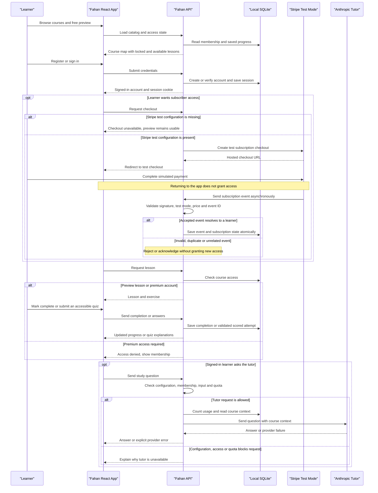

# Core Business Workflows

Fahan Academy helps learners study original lessons, practise scenario questions, and track their preparation. Membership unlocks the full course and, when configured, an AI study tutor.

> **Current MVP:** Local learning and accounts are implemented. Stripe supports test mode only; checkout and the AI tutor require private server configuration. No live payments or Azure deployment are enabled by this document.

## Domain Entities

| Entity | Service / Bounded Context | Description | Key Relationships |
| --- | --- | --- | --- |
| Learner / administrator | Identity | A registered learner, optionally promoted to manage lessons | Owns sessions, progress, quiz attempts, and membership |
| Session | Identity | A time-limited signed-in relationship | Belongs to one account |
| Domain and lesson | Learning | Syllabus grouping and original study material with an exercise | Lessons belong to domains; learners record completions |
| Question and attempt | Assessment | An original practice question and a learner's scored submission | Attempts belong to a learner and domain |
| Subscription | Membership | Local record of provider membership state | Links a learner to a Stripe customer and subscription |
| Provider event | Membership | Receipt used to avoid processing a Stripe event twice | Updates membership when the event qualifies |
| Tutor usage | Study assistance | Per-account daily question consumption | Belongs to a learner |

## Service-to-Domain Mapping

These are logical responsibilities inside **one API**, not independently deployed microservices.

| Service | Domain Context | Owned Entities | External Dependencies |
| --- | --- | --- | --- |
| React dashboard | Learner experience | No authoritative business records | Local API |
| Identity handlers | Account access | Accounts and sessions | Shared local SQLite database |
| Learning and assessment handlers | Course delivery and practice | Completions, attempts, editable lessons; catalog and questions come from curriculum code | Shared local SQLite database |
| Billing handlers | Membership | Local subscription state and processed-event receipts | Stripe test API and signed webhooks |
| Tutor handler | Study assistance | Daily usage counters | Anthropic API and course material |
| Admin handlers | Content management | Lesson edits and first-admin promotion | Shared identity and learning records |

## Primary Workflows

### Workflow 1: Discover, register, and study

1. A visitor opens the dashboard; the API combines the catalog, session, saved completions, and membership state.
2. The visitor searches courses or filters to the free preview.
3. The preview lesson can be read without signing in. Other lessons use the **Course access** rule.
4. Registration applies **Account validation**, hashes the password, creates the account, and starts a session. Login verifies credentials and replaces that account's previous sessions.
5. A signed-in learner marks an accessible lesson complete. The API saves completion, and the dashboard refreshes its progress.

### Workflow 2: Practise and receive feedback

1. A visitor or learner opens the domain-1 preview quiz; other quizzes require membership or administrator access.
2. The API returns question prompts and options without correct answers.
3. A signed-in learner submits a complete answer set.
4. The API applies **Quiz validation**, scores against server-held answers, saves the attempt, and returns explanations.
5. The learner reviews feedback. Practice percentages are not official exam scores or pass predictions.

### Workflow 3: Subscribe and manage access

1. A signed-in learner opens Membership. Missing Stripe configuration produces an explicit unavailable state.
2. With test configuration present, the API creates a Stripe Checkout subscription session using its configured price and the learner's account reference.
3. Stripe hosts checkout. Cancelling leaves existing access unchanged; returning to the app does not itself unlock anything.
4. Stripe sends signed events to `POST /api/billing/webhook`.
5. The API applies **Webhook acceptance** and **Subscription entitlement** rules, then transactionally records the event and any subscription change.
6. A subsequent catalog or lesson request uses the saved membership state. The learner may need to refresh after an asynchronous event arrives.
7. A linked customer can open the test customer portal. Qualifying deletion or inactive-status events remove subscriber access.

### Workflow 4: Ask the AI tutor

1. A signed-in learner asks a study question.
2. The API checks provider configuration, membership, **Tutor validation**, and the daily quota.
3. It records usage before sending the question and course context to Anthropic.
4. It returns the provider's text or an explicit configuration, limit, or upstream error. There is no fabricated-answer fallback.

### Workflow 5: Manage course content

1. A signed-in owner can become the first administrator using a privately configured bootstrap key.
2. An administrator opens the lesson editor and submits revised content.
3. The API applies **Admin content validation** and saves the lesson.
4. Future lesson reads and tutor context use the saved content. Restart seeding preserves existing lesson edits.

## Cross-Service Data Flows

- **Dashboard:** The browser requests session, catalog, and billing data, followed by progress for a signed-in learner. The API joins local account access, course records, and completion data; it does not call Stripe on each lesson request.
- **Payments:** Browser -> API -> Stripe Checkout; Stripe -> signed webhook -> API -> local membership record. A checkout-completed event can link customer details but does not independently grant access.
- **Tutor:** Browser -> API -> Anthropic -> API -> browser. The server sends the learner's question and a bounded course excerpt; provider credentials stay server-side.
- **Failure behavior:** Missing payment configuration keeps checkout unavailable and preserves free preview access. Missing or failing tutor configuration produces an explicit error while lessons remain usable.
- **Deployment boundary:** The current local stack is React/Vite -> Node API -> SQLite. Docker configuration, Kubernetes examples, GitHub Actions checks, and Azure guidance exist, but are not evidence of a deployed cloud service.

## Business Workflow Sequence

Read from top to bottom. This diagram shows the implemented paths; the external-provider branches work only after configuration. The subscription branch is **test-only**, with no real charges.

<!-- mermaid-checked: every participant uses `participant Id as "Label"`, no \n in aliases/messages/notes, every alt/opt/loop closed by end, no `:` inside any alias -->

## Business Rules & Decision Logic

- **Account validation:** Names are 2-80 characters, email must match the server's basic format check and be unique after normalization, and passwords are 10-200 characters. Auth requests are throttled to 30 per IP per 15 minutes. Sessions expire after seven days.
- **Course access:** Lesson `d1-l1` and domain-1 quiz reading are public. Saving progress and submitting quizzes require sign-in. Other lessons and quizzes require an `active` or `trialing` local subscription, or administrator status.
- **Quiz validation:** Exactly one valid option is required for every question in the selected domain. Missing, duplicate, foreign, or out-of-range answers are rejected. Scoring and answer keys remain server-side until feedback is returned.
- **Webhook acceptance:** Validate raw-body signature and timestamp tolerance, require explicit test mode, and deduplicate stored event IDs. Subscription lifecycle events must contain the configured course price.
- **Subscription entitlement:** A qualifying created/updated subscription event grants access only for `active` or `trialing`; other received statuses map to inactive. Deletion maps to canceled. A checkout return URL never grants access; checkout completion alone only links customer/subscription details.
- **Consistency boundary:** Event receipt and membership mutation share a database transaction and roll back together on failure. Out-of-order delivery, missing-event expiry, and provider reconciliation are not yet solved; current behavior must not be presented as production-ready billing.
- **Tutor validation:** Provider key and model must be configured; premium access is required. Questions are 2-2,000 characters, limited to 10 requests per account per UTC day. Failed provider calls still consume usage. Provider timeout is 20 seconds; course context is capped at 24,000 characters.
- **Admin content validation:** Administrator role is required. Titles are 3-120 characters; exercises are 10-1,500 characters; content contains 2-12 paragraphs, each with at least 30 trimmed characters and at most 3,000 characters. First-admin bootstrap requires the correct configured key and no existing administrator.
- **Ownership and progress:** Learners read and update their own progress and attempts. Completion percentage is completed lessons divided by total lessons; syllabus weights describe course emphasis, not study activity.
- **Operational limits:** One API instance owns the local SQLite store. Event receipts, attempts, and completion timestamps are persisted, but there is no comprehensive audit-log service or automatic billing-reconciliation job.

### Source references

- [API workflows and business rules](../../../../../server/index.mjs)
- [Persistence and content seeding](../../../../../server/db.mjs)
- [Dashboard and learner actions](../../../../../src/App.tsx)
- [Setup and production limitations](../../../../../README.md)
