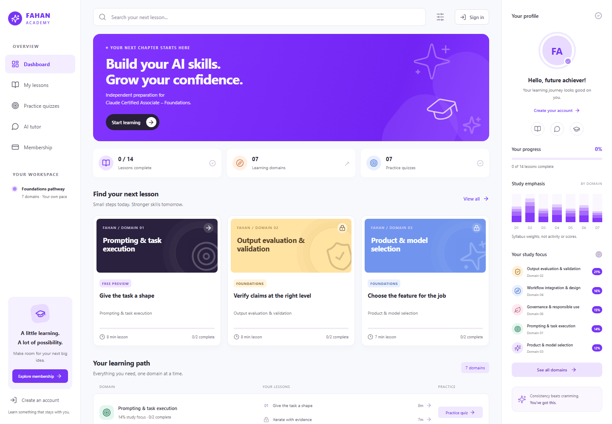

# Fahan Academy

A locally runnable learning-platform MVP with original English-language course content, learner accounts, saved progress, server-scored practice quizzes, administrator lesson editing, an optional Anthropic tutor, and a Stripe **test-mode-only** subscription path.

The study outline uses domain titles, weights, and context from a user-supplied July 2026 guide. Those facts have not been independently verified. Lessons and questions are original educational content, not copied sample questions. This is an independent study resource; it is not affiliated with or endorsed by a certification provider. Practice percentages are not official scaled scores or pass predictions.



## Run locally

Requires Node.js 22.13+ (the built-in `node:sqlite` module is experimental in Node 22) and npm.

```powershell
if (!(Test-Path .env)) { Copy-Item .env.example .env }
# Generate a value with: node -e "console.log(require('crypto').randomBytes(32).toString('base64url'))"
# Put the generated value in SESSION_SECRET in .env.
npm.cmd ci
npm.cmd run dev
```

Open <http://localhost:5180>. The API listens on port 3000 and Vite proxies `/api`. This separate port avoids colliding with other projects. The database is created at `data/fahan-academy.sqlite`; it is not seeded with learners or example credentials. Production-style single-port use (set `APP_ORIGIN=http://localhost:3000` in `.env` first):

```powershell
npm.cmd run build
npm.cmd start
```

Then open <http://localhost:3000>. On Windows where `npm.ps1` is blocked by execution policy, use `npm.cmd`; ensure the Node 22 installation directory is on `PATH`.

### Accounts and admin

Register in the UI. Passwords are scrypt-hashed and the session cookie is HttpOnly, SameSite=Lax, and Secure in production mode. Set `SESSION_SECRET` before starting and keep it stable. Email verification, password recovery, account deletion, and email delivery are not implemented.

To establish the first administrator, set a private `ADMIN_BOOTSTRAP_KEY` in `.env`, register/sign in as the intended owner, then use **Admin setup** in the navigation. The bootstrap key is accepted only while no admin exists; the first successful bootstrap is permanent unless changed manually in the database. Do not expose the key in public clients, source control, or shared logs.

## Learning dashboard

See the [project flow diagram and business workflows](.github/modernize/assessment/engines/facts/business-workflows.md)
for the learner journey, test subscription flow, AI tutor, and access rules.

The purple-and-white dashboard has a desktop navigation sidebar, illustrated
lesson cards, and a learner-profile panel. On smaller screens the navigation
opens from the menu button and the profile panel moves below the course content.
Search matches domain titles, summaries, and lesson titles; the filter button
limits results to the free preview. **View all** and **My lessons** jump to the
course map. Locked lessons still lead to membership rather than bypassing access.
Progress comes from saved lesson completions. The right-hand chart shows syllabus
weights, not invented study activity; lesson cards are reading lessons, not videos.

## Optional integrations

**Anthropic tutor:** Set `ANTHROPIC_API_KEY` and `ANTHROPIC_MODEL` on the server, selecting a currently supported model from your provider account. Missing configuration means an explicit `TUTOR_UNCONFIGURED` response; the app never fabricates tutor answers. An active membership is required when the tutor is configured. The service limits each account to 10 requests per UTC day. Provider calls are external and should be covered by your own privacy, terms, and cost review.

**Stripe:** Only a secret beginning with `sk_test_` is accepted for checkout. Configure `STRIPE_SECRET_KEY`, a server-selected recurring test `STRIPE_PRICE_ID`, and `STRIPE_WEBHOOK_SECRET`; point Stripe test events at `/api/billing/webhook`. Access is activated only from a correctly signed, explicitly test-mode subscription-created/updated event reporting `active` or `trialing` and containing the configured course price; a return URL never grants access. Webhook event IDs are stored idempotently. Checkout, portal, and webhook use Stripe test mode only; there are no live payment keys or links. Business country, tax, pricing, and billing currency are intentionally undecided. Configure and test provider settings before expecting checkout to be available. Subscription event reordering, expiry reconciliation, and provider-level end-to-end testing remain launch blockers.

## Data, limits, and production work

- SQLite is durable for this local **single process / single writer** MVP. Run one instance only; do not put SQLite on a shared network filesystem or scale replicas. Back it up and protect its files.
- Before production or multi-replica deployment, migrate to managed PostgreSQL, add deployment-grade migrations/backups, and test restore and concurrency behavior. The current schema is initialized by `server/db.mjs`; it is not a PostgreSQL migration set.
- The tutor, paid membership, and admin bootstrap are deliberately unavailable until configured. Without Stripe, one lesson and its original quiz are free; other course content is premium-gated. Admin access is never seeded.
- Security and readiness gaps: no independent security review, email verification/password reset, privacy/terms/consent workflow, account deletion/export, support or refund process, tax and local consumer-law setup, accessibility audit, production monitoring/alerting, multi-instance database, automated database migrations, or formal service-level controls. Review these, the current official exam information, and all provider settings before any public launch.
- Docker configuration and deployment examples are provided but have not been container-tested here. Do not deploy the SQLite configuration as a scalable or production persistence design.
- Dependency scan (2026-11-17): the development-only Vite dependency chain includes picomatch 4.0.7, affected by CVE-2026-112366; no patched release is available in the current advisory. Keep the dev server local and recheck before release. The runtime Docker stage does not include that dependency chain.

## Verify

```powershell
npm.cmd run typecheck
npm.cmd test
npm.cmd run build
```

The API tests use an isolated temporary SQLite database and cover registration/login, session state, learner isolation, preview gating, server-side quiz scoring, admin bootstrap/content updates, unconfigured billing/tutor errors, webhook signature verification, idempotency, and subscription access changes.
